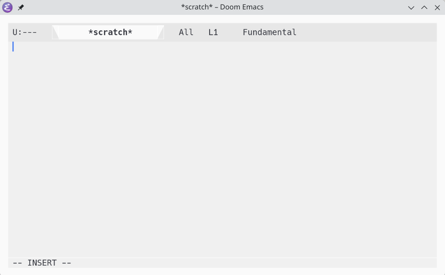

# header-modeline
Move your emacs modeline to the top of the window

(screenshot is using [moody](https://github.com/tarsius/moody) and [spacious-padding](https://github.com/protesilaos/spacious-padding))
